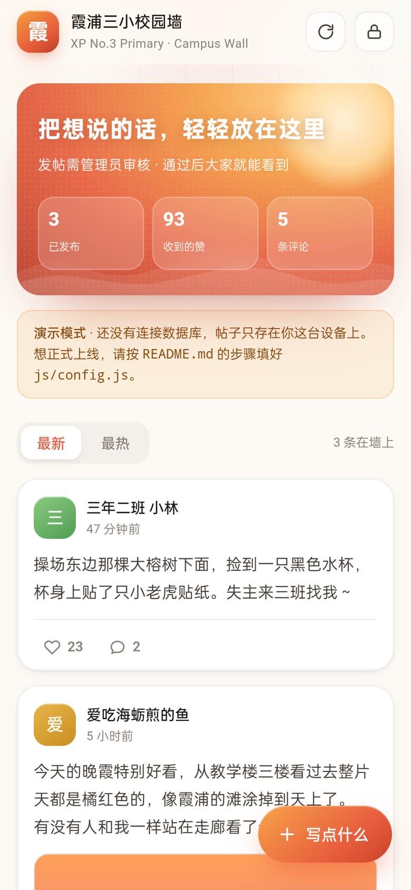
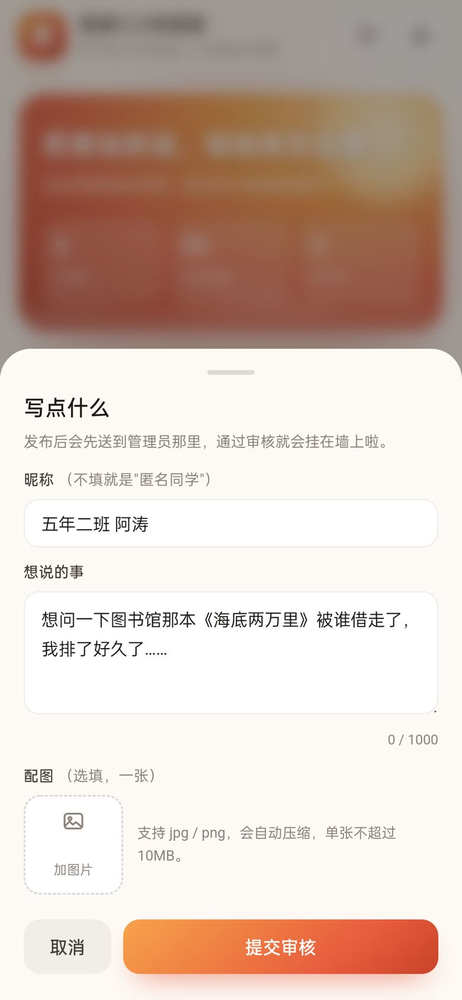

# 霞浦三小校园墙

一个给小学用的「校园墙」网站：学生匿名/署名发帖 → 管理员审核 → 通过后挂在墙上 → 大家点赞、评论。

界面是手工调过的，手机打开就是原生 App 的感觉。

<p align="center">
  
  
  
</p>

---

## 一、先搞清楚一件事：为什么不能只用 GitHub

**GitHub Pages 只能托管「静态文件」**（HTML/CSS/JS），它没有数据库、没有后端。

如果只用 GitHub，那么：

- 帖子存在哪？→ 只能存在每个访客自己的浏览器里，别人看不到
- 谁来审核？→ 没有服务器，没有"审核"这回事
- 点赞数怎么同步？→ 同步不了

所以标准做法是 **两层**：

```
   ┌─────────────────────┐        ┌────────────────────────┐
   │   GitHub Pages      │  读/写  │   Supabase（免费）      │
   │   （前端，免费）      │ ──────▶ │   数据库 + 图片存储     │
   │   给所有人看的网页     │        │   + 管理员账号          │
   └─────────────────────┘        └────────────────────────┘
```

- **GitHub Pages**：放这个文件夹里的网页，免费、无需备案、有 HTTPS
- **Supabase**：免费的云端数据库（Postgres），存帖子 / 点赞 / 评论 / 图片，顺便管管理员登录

两样都不要钱，够一个小学用很久。整套流程大概 20 分钟。

---

## 二、功能清单

| 功能 | 说明 |
|---|---|
| 发帖 | 昵称选填，正文 2–1000 字，可带 1 张图（自动压缩） |
| 审核 | 新帖一律进 `pending` 队列，管理员在 `/admin.html` 通过或拒绝 |
| 点赞 | 一台设备一票，可以取消，数量实时更新 |
| 评论 | 每条帖子下方展开，无需登录 |
| 排序 | 「最新」/「最热」切换 |
| 图片 | 点开看大图 |
| 防绕过 | 发帖走数据库函数，客户端**改不了**帖子状态，直接调 API 也只能提交成待审核 |

---

## 三、目录结构

```
campus-wall/
├── index.html              主页（帖子流 + 发帖）
├── admin.html              审核后台
├── css/style.css           全部样式
├── js/config.js            ★ 只有这个文件需要你改
├── js/store.js             数据层（配了后端走后端，没配走本地演示）
├── js/app.js               主页交互
├── js/admin.js             后台交互
├── vendor/supabase.js      Supabase 官方 SDK（已下载到本地，不依赖 CDN）
├── supabase/schema.sql     ★ 数据库初始化脚本
└── README.md               本文件
```

---

## 四、先本地看一眼（不用任何配置）

在文件夹里开一个本地服务器（不能直接双击 index.html，浏览器的安全策略会拦脚本）：

```bash
# 任选一种
python3 -m http.server 8000
npx serve .
```

然后浏览器打开 <http://localhost:8000>。

这时候页面顶部会有一条黄色提示「演示模式」。这是正常的——它用浏览器本地存储假装有个数据库，**所有功能都能点**：发帖、审核、点赞、评论，数据只存在你这台设备上。

先看看样子，满意了再往下做真部署。

管理员后台是 <http://localhost:8000/admin.html>（演示模式下不用登录直接进）。

---

## 五、正式部署 · 第一步：Supabase（后端）

### 5.1 注册并建项目

1. 打开 <https://supabase.com> → 右上角 **Start your project**
2. 用 GitHub 账号登录最省事（没有就注册一个，反正后面也要用）
3. 点 **New project**，填：

| 字段 | 填什么 |
|---|---|
| Organization | 默认那个就行 |
| Name | `campus-wall` |
| Database Password | 随便生成一个强密码，**记下来** |
| Region | **Southeast Asia (Singapore)** —— 离国内最近，速度最快 |
| Pricing Plan | Free |

4. 点 **Create new project**，等 1–2 分钟初始化

> ⚠️ 免费版项目 **7 天没有任何访问会被自动暂停**。暂停后打开网站会报错，进 Supabase 后台点一下 Restore 就恢复。避免办法见第十节。

### 5.2 建表（一次粘贴搞定）

1. 左侧菜单点 **SQL Editor** → **New query**
2. 打开本项目里的 `supabase/schema.sql`，**全选复制**，粘贴进去
3. 点右下角 **Run**（或按 Ctrl/Cmd + Enter）

看到 `Success. No rows returned` 就对了。

这个脚本做了：

- 建 4 张表：`posts`（帖子）、`post_likes`（点赞）、`comments`（评论）、`admins`（管理员名单）
- 建 5 个函数：发帖、点赞、评论、读评论、判断管理员（**强制审核**的关键就在这）
- 开行级安全（RLS）+ 精确收回默认权限 —— 匿名访客只读得到「已通过」的帖子
- **建好 `post-images` 图片桶**（public，单文件 10MB 上限，只收图片类型）
- 配好图片的读写策略

脚本是**幂等**的，跑失败了改一下可以再跑一遍。

> 💡 桶也包含在这段 SQL 里了 —— **不需要**再去 Storage 页面手动建。
> 如果你是先建桶再跑 SQL 也没关系，`on conflict do update` 会把配置补正过来。

### 5.3 ~~建图片存储桶~~（已合并进上一步，跳过）

早期版本需要手动去 Storage 建桶，现在是建表脚本的一部分了。跑完 5.2 之后去 **Storage** 页面看一眼，能看到 `post-images` 就说明成功。

### 5.4 建管理员账号

1. 左侧 **Authentication** → **Users** → **Add user** → **Create new user**
2. 填邮箱（不用真能收信，`admin@school.com` 这种也行）和密码
3. **勾上 Auto Confirm User**（不勾的话要验证邮箱才能登录）
4. 点 **Create user**

> 顺便把注册关掉，免得别人自己注册：**Authentication → Sign In / Providers → Email** 里把 **Enable sign ups** 关掉。

### 5.5 把这个账号设成管理员

1. 在 **Authentication → Users** 列表里找到刚建的账号，**点进详情页，复制那个 UUID**（形如 `3f2a9c1e-...`）
2. 回到 **SQL Editor**，新建 query，粘贴执行（把 UUID 换成你的）：

```sql
insert into public.admins (user_id)
values ('这里粘贴你的管理员UUID')
on conflict do nothing;
```

3. 顺手验证一下：

```sql
select * from public.admins;
```

能看到一行就对了。**只有这张表里的账号，登录 `/admin.html` 才有权限审核。**

### 5.6 拿到两个值

左侧 **Project Settings → API**（新版界面叫 **Settings → API Keys**），复制：

- **Project URL** —— 形如 `https://abcdefghijkl.supabase.co`
- **anon / public key** —— 一长串 `eyJhbGciOi...`

> `anon key` 是**设计上就公开**的，放在前端不怕。真正管事的是数据库的 RLS 策略——我们已经配好了。
> ⚠️ 但那个 `service_role key` 千万别碰、别贴到任何地方，它能绕过所有权限。

---

## 六、正式部署 · 第二步：GitHub Pages（前端）

### 6.1 建仓库

1. 登录 <https://github.com>，右上角 **+** → **New repository**
2. Repository name：`campus-wall`
3. 选 **Public**（私有仓库用 Pages 要付费）
4. **不要**勾 Add a README（我们自己的 README 会覆盖它）
5. **Create repository**

### 6.2 上传文件

**方法 A：网页拖拽（最简单，不用装任何东西）**

1. 在新建的空仓库页面点 **uploading an existing file**
2. 把 `campus-wall` 文件夹里的**所有东西**（index.html、admin.html、css/、js/、vendor/、supabase/、README.md）拖进去
3. 底部 **Commit changes**

> 注意：文件夹要整体拖，保持 `css/style.css` 这种层级关系。如果拖不进去，就用方法 B。

**方法 B：命令行（推荐，以后改东西方便）**

```bash
cd campus-wall

git init
git add .
git commit -m "校园墙第一版"
git branch -M main
git remote add origin https://github.com/你的用户名/campus-wall.git
git push -u origin main
```

如果把仓库建在了别的名字下，记得改上面的 URL。

### 6.3 打开 Pages

1. 仓库页 → **Settings** → 左侧 **Pages**
2. **Source** 选 `Deploy from a branch`
3. **Branch** 选 `main`，右侧文件夹选 `/ (root)`
4. **Save**
5. 等 1–2 分钟刷新页面，顶部会出现：

```
Your site is live at https://你的用户名.github.io/campus-wall/
```

这个网址就是校园墙的地址，手机也能直接打开。

### 6.4 ⭐ 填配置（最后一步，不做这一步网站是空白的演示模式）

1. 在本机打开 `js/config.js`
2. 把 5.6 里复制的两个值填进去：

```js
window.WALL_CONFIG = {
  SUPABASE_URL: "https://abcdefghijkl.supabase.co",
  SUPABASE_ANON_KEY: "eyJhbGciOiJIUzI1NiIsInR5cCI6IkpXVCJ9....",

  STORAGE_BUCKET: "post-images",

  SITE_TITLE: "霞浦三小校园墙",
  SITE_SLOGAN: "把想说的话，轻轻放在这里",
  MAX_IMAGES: 1
};
```

3. 提交回 GitHub：

- 网页方式：仓库里点开 `js/config.js` → 右上角铅笔图标 → 改 → **Commit changes**
- 命令行：`git add . && git commit -m "配置后端" && git push`

4. 等 1 分钟，刷新网站。顶部那条「演示模式」黄条会消失 —— 说明后端连上了。

### 6.5 验收清单

按顺序点一遍，全部通过就算上线成功：

- [ ] 首页能正常显示（没有黄条）
- [ ] 点「写点什么」→ 填内容 → 提交 → 弹出「已提交，等管理员审核」
- [ ] 打开 `/admin.html` → 用 5.4 建的邮箱密码登录 → 待审核区能看到刚才那条
- [ ] 点「✓ 通过并发布」→ 回到首页刷新 → 帖子出现了
- [ ] 点一下爱心 → 数字 +1，刷新页面还是红的
- [ ] 展开评论 → 发一条 → 显示出来
- [ ] 发一条带图的帖子 → 审核通过 → 图片能正常显示

---

## 七、日常怎么用

### 学生端

直接打开网址，不用注册、不用登录。想发就发，发完会告诉他们「等审核」。

### 管理员端

1. 打开 `https://你的用户名.github.io/campus-wall/admin.html`
2. 输邮箱密码登录
3. **待审核**区：每条下面三个按钮
   - **✓ 通过并发布** —— 立刻出现在墙上了
   - **✕ 不通过** —— 会问你写个原因，只记在后台，学生看不到
   - **删除** —— 彻底删掉（含评论）
4. **已通过的帖子**区：可以**下架**（退回待审核）或**删除**

建议每天放学后花 2 分钟过一遍待审核区。

> 手机上也能用，把 admin.html 那个网址加到主屏幕就是一个 App 图标。

---

## 八、反滥用措施（已内置）

| 风险 | 处理方式 |
|---|---|
| 有人伪造「已审核」状态 | 发帖只能调用 `submit_post()` 函数，函数里**写死** `status='pending'`，客户端传什么状态都不作数 |
| 有人拿 anon key 直接写数据库 | 表级权限已收回，`insert` 根本给不到 `anon` |
| 有人读待审核的帖子 | RLS 策略 `status='approved'`，未通过的根本查不出来 |
| 有人刷赞 | 设备指纹 + `(post_id, client_id)` 主键，一台设备一票 |
| 有人刷帖 | 同名同内容 60 秒内只能提一次 + 人工审核兜底 |

已知的局限（小学场景够用，但要心里有数）：

- 设备指纹存在 `localStorage`，清缓存就能再投一票 —— 真想严谨就得做登录，那体验就不是「随便发」了
- 图片桶对匿名用户开放上传 —— 理论上有人能传垃圾文件，但传了也没有帖子引用它，且免费额度只有 1GB
- 评论区没有审核 —— 只能事后由管理员删帖删除。如果学校要求「评论也要先审」，告诉我，我加一个 `comments.status` 字段

---

## 九、以后想改东西

| 想改什么 | 改哪里 |
|---|---|
| 页眉标题、口号 | `js/config.js` 里的 `SITE_TITLE` / `SITE_SLOGAN`，或直接改 `index.html` 的 `<h1>` |
| 主色调 | `css/style.css` 顶部 `:root` 里的 `--brand` / `--gold` / `--sea` |
| 发帖字数上限 | `supabase/schema.sql` 的 `submit_post` 函数（改完要重新 Run 一次）+ `index.html` 里 `maxlength` |
| 昵称字数上限 | 同上 |
| 审核后自动刷新 | 现在是进入页面和切回标签页时刷新，够用 |

改完 commit + push，GitHub Pages 一分钟内自动更新。

---

## 十、常见问题

**Q：改了 `config.js` 没生效，还是黄条**
浏览器缓存。强制刷新：电脑上按 `Ctrl + Shift + R`（Mac 是 `Cmd + Shift + R`）；手机浏览器用无痕窗口打开试试。GitHub Pages 的缓存最长 10 分钟，等等也会自己好。

**Q：网站打开是白屏 / 顶部一直是黄条「演示模式」**
`js/config.js` 没填或填错了。注意 URL 结尾**不要**加斜杠，key 要完整复制（很长，别漏了尾部）。

**Q：发帖提示 `new row violates row-level security policy`**
`supabase/schema.sql` 没跑全，或者跑的过程中报错了。去 SQL Editor 重新整段跑一次。

**Q：图片上传失败 `Bucket not found`**
Storage 里没建 `post-images` 桶，或者名字拼错了（大小写敏感）。

**Q：登录后台提示「这个账号不是管理员」**
`public.admins` 表里没有这个用户。回到 5.5 用 UUID 插一行。

**Q：过几天再打开，网站报错 / 一直加载**
Supabase 免费版项目 7 天没访问被暂停了。去 <https://supabase.com/dashboard> 找到项目点 **Restore**。想避免就每周让网站有人访问一次，或者用 [UptimeRobot](https://uptimerobot.com) 免费监控（5 分钟 ping 一次，但注意它的 ping 走的是 HTTP 请求，可以直接监控网站地址，这样项目就有活动了）。

**Q：国内访问 `xxx.github.io` 很慢 / 打不开**
`github.io` 在国内网络下不稳定，这是 GitHub 的问题不是代码的问题。三个选择：
1. 学生用手机流量通常能开
2. 换 **Cloudflare Pages** 托管（同样免费，把整个文件夹拖进去就行，国内一般比 github.io 稳）
3. 学校有条件的话，买个域名绑到 Cloudflare Pages 上

**Q：能不能用自己的域名？**
能。仓库 Settings → Pages → Custom domain 填域名，然后在域名服务商那里加一条 CNAME 指向 `你的用户名.github.io`。国内未备案的域名指向境外服务器可能被拦，学校域名要先问信息老师。

**Q：数据能导出吗？**
能。Supabase 后台 → Table Editor → 右上角可以导出 CSV；或 SQL Editor 跑 `select * from posts;` 然后下载结果。

**Q：能加"帖子里放多张图"吗？**
可以，但需要改 `posts` 表结构（加一个 `images text[]` 字段）。现在的版本为了简单只支持 1 张。

---

## 十一、安全提醒

- 这个站点的**代码和 anon key 都是公开可见的**，这是正常的，安全性由数据库策略保证
- 千万不要把 **service_role key** 写进任何前端文件
- 管理员的**邮箱密码要保管好**，别用学校公用的那台电脑的浏览器记住密码
- 学生的真实姓名、电话、家庭住址 —— 这些别写进帖子。如果要在网站上提示，改 `index.html` 里 textarea 的 `placeholder`
- 建议在开学第一课讲一下：发帖要负责任，网络不是法外之地

---

## 十二、许可

这个项目你可以随便用、随便改，不用署名。
