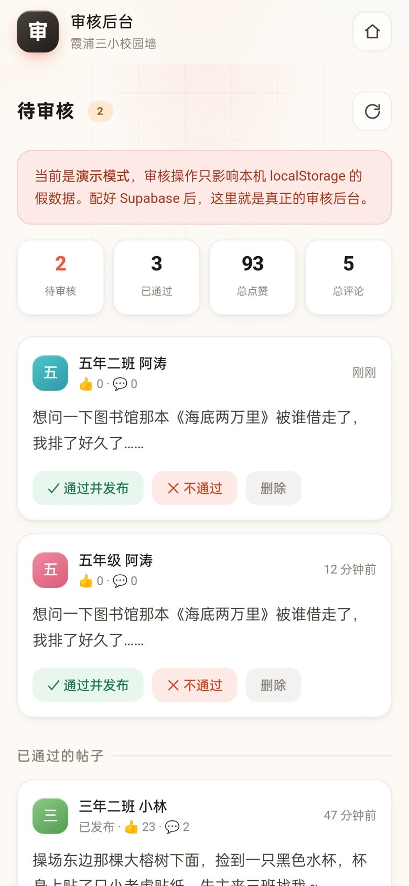

# 霞浦三小校园墙

一个给小学用的「校园墙」网站：学生匿名/署名发帖 → 管理员审核 → 通过后挂在墙上 → 大家点赞、评论。

界面是手工调过的，手机打开就是原生 App 的感觉。

<p align="center">
  
  
  
</p>

---

## 一、先搞清楚一件事：为什么不能只用 GitHub

**GitHub Pages 只能托管「静态文件」**（HTML/CSS/JS），它没有数据库、没有后端。

如果只用 GitHub，那么：

- 帖子存在哪？→ 只能存在每个访客自己的浏览器里，别人看不到
- 谁来审核？→ 没有服务器，没有"审核"这回事
- 点赞数怎么同步？→ 同步不了

所以标准做法是 **两层**：

```
   ┌─────────────────────┐        ┌────────────────────────┐
   │   GitHub Pages      │  读/写  │   Supabase（免费）      │
   │   （前端，免费）      │ ──────▶ │   数据库 + 图片存储     │
   │   给所有人看的网页     │        │   + 管理员账号          │
   └─────────────────────┘        └────────────────────────┘
```

- **GitHub Pages**：放这个文件夹里的网页，免费、无需备案、有 HTTPS
- **Supabase**：免费的云端数据库（Postgres），存帖子 / 点赞 / 评论 / 图片，顺便管管理员登录

两样都不要钱，够一个小学用很久。整套流程大概 20 分钟。

---

## 二、功能清单

| 功能 | 说明 |
|---|---|
| 发帖 | 用你在个人中心设的头像和昵称发，也可以一键**匿名发布** |
| 审核 | 新帖一律进 `pending` 队列，管理员在 `/admin.html` 通过或拒绝 |
| 置顶 | 管理员可以把重要帖子钉在墙的最上面 |
| 点赞 | 一台设备一票，可以取消 |
| 评论 | 每条帖子下方展开，无需登录 |
| 排序 | 「最新」/「最热」切换，置顶永远在最前 |
| 个人中心 | 从 24 个 emoji 里挑头像、起昵称、写一句签名 |
| 加好友 | **点任何帖子的头像** → 弹出用户卡 → 加好友；对方同意后就能聊天 |
| 私聊 | 一对一聊天，支持实时推送（对方发来立刻出现），断线时 15 秒轮询兜底 |
| 自动刷新 | 首页每 15 秒静默拉一次数据，**不打断**你正在看的帖子、输入框和滚动位置 |
| 学校简介 | 首页一张入口卡，点进去是独立的「若水教育」长页（校史 / 文化 / 荣誉 / 校刊 / 校歌） |
| 帖子分类 | 灌水贴 / 吐槽 / 失物招领 / 挂人，首页顶部可按分类筛选 |
| 关键词搜索 | 顶部搜索框，按内容或昵称找帖子 |
| 评论回复 | 楼中楼（只嵌一层），回复箭头指向具体某条评论 |
| 开屏公告 | 读仓库里的 `announcement.json`，改文件就改公告，版本变了才重新弹 |
| 管理员任命 | 后台「管理员」页搜昵称，一键把别人升成管理员 |
| 封禁 | 按设备码 + 账号双封，可设时长或永久，后台可解封 |
| 昵称查重 | 个人中心输名字实时检查，重名直接拦住 |
| 消息通知 | 页面在后台时弹系统通知 + 提示音 + 标题闪动 |
| 图片 | 点开看大图 |
| 防绕过 | 发帖走数据库函数，客户端**改不了**帖子状态，直接调 API 也只能提交成待审核 |

**身份是怎么来的？** 用 Supabase 的「匿名登录」：打开网页自动获得一个真实身份，不用注册、不用记密码。好处是好友和消息有真正的权限隔离——别人拿不到你的 JWT 就没法冒充你。代价是：**清浏览器缓存会丢身份**（好友和聊天记录跟着没了），所以换设备前先想清楚。

---

## 三、目录结构

```
campus-wall/
├── index.html              主页（帖子流 + 发帖 + 用户卡）
├── me.html                 个人中心（头像 / 昵称 / 好友）
├── chat.html               消息与聊天
├── admin.html              审核后台（审核 + 置顶）
├── xiapu/                  ★ 学校简介（独立站点，原样放进来即可）
│   ├── index.html          若水教育 · 校史/文化/荣誉/校刊/校歌
│   ├── css/ js/ media/ audio/
├── css/style.css           全部样式
├── js/config.js            ★ 只有这个文件需要你改
├── js/store.js             数据层（帖子 / 点赞 / 评论 / 置顶）
├── js/social.js            身份（匿名登录）/ 好友 / 私聊
├── js/app.js               主页交互 + 15 秒静默刷新
├── js/me.js                个人中心
├── js/chat.js              消息与聊天
├── js/admin.js             后台交互
├── vendor/supabase.js      Supabase 官方 SDK（已下载到本地，不依赖 CDN）
├── supabase/schema.sql     ★ 全新安装用（已含 v2 全部内容）
├── supabase/migration-v2.sql  已在运行的项目升级用
└── README.md               本文件
```

---

## 四、先本地看一眼（不用任何配置）

在文件夹里开一个本地服务器（不能直接双击 index.html，浏览器的安全策略会拦脚本）：

```bash
# 任选一种
python3 -m http.server 8000
npx serve .
```

然后浏览器打开 <http://localhost:8000>。

这时候页面顶部会有一条黄色提示「演示模式」。这是正常的——它用浏览器本地存储假装有个数据库，**所有功能都能点**：发帖、审核、点赞、评论，数据只存在你这台设备上。

先看看样子，满意了再往下做真部署。

管理员后台是 <http://localhost:8000/admin.html>（演示模式下不用登录直接进）。

---

## 五、正式部署 · 第一步：Supabase（后端）

> ### ⚠️ 开工前先记住三个开关
>
> 下面有三个东西**必须**打开，少一个功能就残：
>
> 1. **Anonymous sign-ins**（匿名登录）→ 不开：没法加好友、没法聊天
> 2. **Storage 的 `post-images` 桶** → 已在 SQL 里自动建，只需确认
> 3. **Realtime（实时）** → 已在 SQL 里自动加，只需确认
>
> 前两个都是"打开一次，永久生效"。

### 5.1 注册并建项目

1. 打开 <https://supabase.com> → 右上角 **Start your project**
2. 用 GitHub 账号登录最省事（没有就注册一个，反正后面也要用）
3. 点 **New project**，填：

| 字段 | 填什么 |
|---|---|
| Organization | 默认那个就行 |
| Name | `campus-wall` |
| Database Password | 随便生成一个强密码，**记下来** |
| Region | **Southeast Asia (Singapore)** —— 离国内最近，速度最快 |
| Pricing Plan | Free |

4. 点 **Create new project**，等 1–2 分钟初始化

> ⚠️ 免费版项目 **7 天没有任何访问会被自动暂停**。暂停后打开网站会报错，进 Supabase 后台点一下 Restore 就恢复。避免办法见第十节。

### 5.2 开启匿名登录（必做，30 秒）

1. 左侧 **Authentication** → **Sign In / Providers**
2. 找到 **Anonymous sign-ins**，把开关打开 ✅
3. 往下找 **Rate Limits**，把 **Anonymous sign-ins** 那个限额调大（默认每小时每 IP 30 次）

> **为什么第 3 步很重要？** 学生都在学校 WiFi 上，出口是**同一个 IP**。
> 默认 30 次/小时意味着：第 31 个打开网页的同学会直接登录失败，页面会报错。
> 一个班 40 人，课间一起来就爆了。建议直接填 **1000**（或按学校人数 ×3 填）。

### 5.3 建表（一次粘贴搞定）

1. 左侧菜单点 **SQL Editor** → **New query**
2. 打开本项目里的 `supabase/schema.sql`，**全选复制**，粘贴进去
3. 点右下角 **Run**（或按 Ctrl/Cmd + Enter）

看到 `Success. No rows returned` 就对了。

这个脚本做了：

- 建 4 张表：`posts`（帖子）、`post_likes`（点赞）、`comments`（评论）、`admins`（管理员名单）
- 建 5 个函数：发帖、点赞、评论、读评论、判断管理员（**强制审核**的关键就在这）
- 开行级安全（RLS）+ 精确收回默认权限 —— 匿名访客只读得到「已通过」的帖子
- **建好 `post-images` 图片桶**（public，单文件 10MB 上限，只收图片类型）
- 配好图片的读写策略

脚本是**幂等**的，跑失败了改一下可以再跑一遍。

> 💡 桶也包含在这段 SQL 里了 —— **不需要**再去 Storage 页面手动建。
> 如果你是先建桶再跑 SQL 也没关系，`on conflict do update` 会把配置补正过来。

### 5.4 确认图片桶建好了

跑完建表脚本后，去 **Storage** 看一眼，应该能看到 `post-images`。有就对了，**不用手动建**。

### 5.5 建管理员账号

1. 左侧 **Authentication** → **Users** → **Add user** → **Create new user**
2. 填邮箱（不用真能收信，`admin@school.com` 这种也行）和密码
3. **勾上 Auto Confirm User**（不勾的话要验证邮箱才能登录）
4. 点 **Create user**

> 顺便把注册关掉，免得别人自己注册：**Authentication → Sign In / Providers → Email** 里把 **Enable sign ups** 关掉。

### 5.6 把这个账号设成管理员

1. 在 **Authentication → Users** 列表里找到刚建的账号，**点进详情页，复制那个 UUID**（形如 `3f2a9c1e-...`）
2. 回到 **SQL Editor**，新建 query，粘贴执行（把 UUID 换成你的）：

```sql
insert into public.admins (user_id)
values ('这里粘贴你的管理员UUID')
on conflict do nothing;
```

3. 顺手验证一下：

```sql
select * from public.admins;
```

能看到一行就对了。**只有这张表里的账号，登录 `/admin.html` 才有权限审核。**

### 5.7 拿到两个值

左侧 **Project Settings → API**（新版界面叫 **Settings → API Keys**），复制：

- **Project URL** —— 形如 `https://abcdefghijkl.supabase.co`
- **anon / public key** —— 一长串 `eyJhbGciOi...`

> `anon key` 是**设计上就公开**的，放在前端不怕。真正管事的是数据库的 RLS 策略——我们已经配好了。
> ⚠️ 但那个 `service_role key` 千万别碰、别贴到任何地方，它能绕过所有权限。

---

## 六、正式部署 · 第二步：GitHub Pages（前端）

### 6.1 建仓库

1. 登录 <https://github.com>，右上角 **+** → **New repository**
2. Repository name：`campus-wall`
3. 选 **Public**（私有仓库用 Pages 要付费）
4. **不要**勾 Add a README（我们自己的 README 会覆盖它）
5. **Create repository**

### 6.2 上传文件

**方法 A：网页拖拽（最简单，不用装任何东西）**

1. 在新建的空仓库页面点 **uploading an existing file**
2. 把 `campus-wall` 文件夹里的**所有东西**（index.html、admin.html、css/、js/、vendor/、supabase/、README.md）拖进去
3. 底部 **Commit changes**

> 注意：文件夹要整体拖，保持 `css/style.css` 这种层级关系。如果拖不进去，就用方法 B。

**方法 B：命令行（推荐，以后改东西方便）**

```bash
cd campus-wall

git init
git add .
git commit -m "校园墙第一版"
git branch -M main
git remote add origin https://github.com/你的用户名/campus-wall.git
git push -u origin main
```

如果把仓库建在了别的名字下，记得改上面的 URL。

### 6.3 打开 Pages

1. 仓库页 → **Settings** → 左侧 **Pages**
2. **Source** 选 `Deploy from a branch`
3. **Branch** 选 `main`，右侧文件夹选 `/ (root)`
4. **Save**
5. 等 1–2 分钟刷新页面，顶部会出现：

```
Your site is live at https://你的用户名.github.io/campus-wall/
```

这个网址就是校园墙的地址，手机也能直接打开。

### 6.4 ⭐ 填配置（最后一步，不做这一步网站是空白的演示模式）

1. 在本机打开 `js/config.js`
2. 把 5.7 里复制的两个值填进去：

```js
window.WALL_CONFIG = {
  SUPABASE_URL: "https://abcdefghijkl.supabase.co",
  SUPABASE_ANON_KEY: "eyJhbGciOiJIUzI1NiIsInR5cCI6IkpXVCJ9....",

  STORAGE_BUCKET: "post-images",

  SITE_TITLE: "霞浦三小校园墙",
  SITE_SLOGAN: "把想说的话，轻轻放在这里",
  MAX_IMAGES: 1
};
```

3. 提交回 GitHub：

- 网页方式：仓库里点开 `js/config.js` → 右上角铅笔图标 → 改 → **Commit changes**
- 命令行：`git add . && git commit -m "配置后端" && git push`

4. 等 1 分钟，刷新网站。顶部那条「演示模式」黄条会消失 —— 说明后端连上了。

### 6.5 验收清单

按顺序点一遍，全部通过就算上线成功：

- [ ] 首页能正常显示（没有黄条）
- [ ] 点「写点什么」→ 填内容 → 提交 → 弹出「已提交，等管理员审核」
- [ ] 打开 `/admin.html` → 用 5.5 建的邮箱密码登录 → 待审核区能看到刚才那条
- [ ] 点「✓ 通过并发布」→ 回到首页刷新 → 帖子出现了
- [ ] 点一下爱心 → 数字 +1，刷新页面还是红的
- [ ] 展开评论 → 发一条 → 显示出来
- [ ] 发一条带图的帖子 → 审核通过 → 图片能正常显示
- [ ] 点头像能弹出用户卡（v2）
- [ ] 两个浏览器 / 两个设备互相加好友能成功（v2）
- [ ] 聊天发消息，另一个窗口 2 秒内自动出现（v2）
- [ ] 首页能看到「学校简介」卡片，点进去能正常滚动，左上角「‹ 校园墙」能回来

---

## 七、已经在运行？从 v1 升级到 v2

如果你之前部署过不带好友/聊天的版本，三步升上来：

**第 1 步：开匿名登录**（同 5.2）
Authentication → Sign In / Providers → **Anonymous sign-ins** 打开，Rate Limits 调大。

**第 2 步：跑增量 SQL**
SQL Editor → New query → 粘贴 `supabase/migration-v2.sql` → Run。

> 这个脚本只做「加表、加字段、加函数」，**不会动你现有的帖子和评论**。
> 跑完在 Table Editor 里应该能看到 `profiles`、`friendships`、`messages` 三张新表。

**第 3 步：重新上传这些文件**

```
index.html   me.html   chat.html
css/style.css
js/store.js  js/app.js  js/social.js  js/me.js  js/chat.js  js/admin.js
README.md
```

> 之后新装的人直接用 `schema.sql` 就行，它已经包含 v2 全部内容。

---

## 七之二、从 v2 升级到 v3（分类 / 搜索 / 回复 / 封禁 / 公告）

**只有一步：跑 SQL。**

SQL Editor → New query → 粘贴 `supabase/migration-v3.sql` → Run。

> ⚠️ **一定要先跑 SQL，再推代码。** v3 的列表查询多选了 `category` 字段，
> 库里没有这列的话，主页会直接白屏。（我加了降级兜底，会退回旧字段继续显示，
> 但分类筛选和搜索用不了。）

跑完在 Table Editor 里能看到新表 `bans`，`posts` 表多出 `category` 列就对了。

然后是这些文件：

```
index.html  admin.html  me.html  announcement.json
css/style.css
js/app.js  js/store.js  js/admin.js  js/me.js  js/notify.js
```

### 关于公告（`announcement.json`）

改动方式：直接编辑仓库根目录的 `announcement.json`。

```json
{
  "version": "2026-11-26-1",   ← 改了内容就把这个改掉，否则学生看不到新公告
  "title": "校园墙使用须知",
  "rules": ["这是校园墙，🈲黄", "🈲引流", "🈲刷屏"],
  "changelog": "本次更新：……",
  "footer": "违规内容会被删除，严重者封禁账号。"
}
```

- **`version` 是唯一判断依据**：和上次一样就不弹，改一个字就重新弹一次
- 学生点过「我知道了」会记住这个版本号，存在自己浏览器里
- 想强制所有人再看一遍？把 version 改成 `2026-11-27-1` 这种新值

### 关于通知，说清楚边界

网页能做到的：
- ✅ 页面开着（哪怕切到别的 App），弹 **Android 通知栏**的系统通知
- ✅ 提示音（WebAudio 合成的「叮咚」，不依赖音频文件）
- ✅ 标题栏闪红点
- ✅ 页面在前台时只显示站内提示，不吵

做不到的：
- ❌ **页面完全关掉之后还能收到推送**。这需要 Service Worker + Push 服务端（VAPID 密钥 + 一个常驻的函数），Supabase 免费版能做但要额外部署 Edge Function，而且 iOS 上限制更严。
- 所以本质上是「打开着能收到」，不是微信那种「关了也能收」。

学生第一次进站会弹一次通知授权框，同意了才有系统通知。

### 关于封禁，也说清楚边界

封的是 **设备码 + 账号** 两个维度：
- 账号（`auth.uid()`）—— 改了也绕不过，因为服务端认这个
- 设备码（浏览器 localStorage 里的随机串）—— 清缓存会换一个

**所以理论上：清掉浏览器数据 + 换个浏览器，就能绕开设备封禁。** 匿名身份体系天然有这个天花板。
真要封死只能上「手机号验证」这类实名手段，那是另一个量级的工程。

实际效果：能挡住 95% 的小学生（他们不会想到清缓存）。

学生的设备码在**个人中心底部**能看到，封之前可以让他报上来。

---


## 八、日常怎么用

### 学生端

直接打开网址，不用注册、不用登录。想发就发，发完会告诉他们「等审核」。

**第一次用建议先做一件事**：点右上角的头像 → 个人中心 → 挑个 emoji 头像、起个名字。不然帖子会按「同学a3f2」这种默认名显示。

- **发帖**：点「写点什么」。默认用你的头像昵称；想匿名就打开「匿名发布」开关，头像会变成 🙈，别人点不进你的资料。
- **加好友**：点任何帖子上的**头像**（不是名字）→ 弹出卡片 → 「加好友」。等对方同意。
- **聊天**：右上角气泡图标。有未读会显示红色数字。
- **实时**：对方发消息，你这边**秒到**；如果网络不支持实时，15 秒内也会自动刷出来。

### 管理员端

1. 打开 `https://你的用户名.github.io/campus-wall/admin.html`
2. 输邮箱密码登录
3. **待审核**区：每条下面三个按钮
   - **✓ 通过并发布** —— 立刻出现在墙上了
   - **✕ 不通过** —— 会问你写个原因，只记在后台，学生看不到
   - **删除** —— 彻底删掉（含评论）
4. **已通过的帖子**区：
   - **📌 置顶** —— 钉在墙的最上面，再点一下取消
   - **下架** —— 退回待审核
   - **删除**

置顶最适合放：校规提醒、失物招领、活动通知。别超过 2 条，多了墙就不好看了。

建议每天放学后花 2 分钟过一遍待审核区。

> 手机上也能用，把 admin.html 那个网址加到主屏幕就是一个 App 图标。

---

## 九、反滥用措施（已内置）

| 风险 | 处理方式 |
|---|---|
| 有人伪造「已审核」状态 | 发帖只能调用 `submit_post()` 函数，函数里**写死** `status='pending'`，客户端传什么状态都不作数 |
| 有人拿 anon key 直接写数据库 | 表级权限已收回，`insert` 根本给不到 `anon` |
| 有人读待审核的帖子 | RLS 策略 `status='approved'`，未通过的根本查不出来 |
| 有人刷赞 | 设备指纹 + `(post_id, client_id)` 主键，一台设备一票 |
| 有人刷帖 | 同名同内容 60 秒内只能提一次 + 人工审核兜底 |
| 有人冒充别人发帖 | 身份是匿名登录拿到的 JWT，改昵称可以，改 `auth.uid()` 不行 |
| 有人偷看别人的私聊 | `messages` 的 RLS 只放行 `sender=我 or receiver=我`，别人的消息查不到 |
| 有人直接往别人会话里插消息 | 只能走 `send_message()`，函数里校验**必须是好友** |
| 有人篡改别人发来的消息内容 | 只给了 `update(read_at)` 这一列权限，`content` 改不了 |
| 有人无限发消息 | 1 秒 1 条限流 + 每条 500 字上限 |
| 有人给自己改 created_at / 伪造注册时间 | 资料表只给了 `update(nickname, avatar, bio)` 三列 |
| 有人置顶自己的帖子 | `admin_set_pinned()` 里校验 `is_admin()`，非管理员调用直接报错 |

已知的局限（小学场景够用，但要心里有数）：

- 设备指纹存在 `localStorage`，清缓存就能再投一票 —— 真想严谨就得做登录，那体验就不是「随便发」了
- 图片桶对匿名用户开放上传 —— 现在有 10MB + 4 种格式的限制，且免费额度只有 1GB
- **评论区没有审核** —— 只能事后由管理员删帖删除。如果学校要求「评论也要先审」，跟我说，我加一个 `comments.status` 字段
- **私聊内容管理员看不到** —— 这是隐私设计。如果学校要求能查（比如防霸凌），需要加只读的管理视图，那是另一个取舍
- **匿名身份换设备就丢** —— 见常见问题里的说明

---

## 十、以后想改东西

| 想改什么 | 改哪里 |
|---|---|
| 页眉标题、口号 | `js/config.js` 里的 `SITE_TITLE` / `SITE_SLOGAN`，或直接改 `index.html` 的 `<h1>` |
| 主色调 | `css/style.css` 顶部 `:root` 里的 `--brand` / `--gold` / `--sea` |
| 发帖字数上限 | `supabase/schema.sql` 的 `submit_post` 函数（改完要重新 Run 一次）+ `index.html` 里 `maxlength` |
| 昵称字数上限 | 同上 |
| 审核后自动刷新 | 现在是进入页面和切回标签页时刷新，够用 |

改完 commit + push，GitHub Pages 一分钟内自动更新。

---

## 十一、常见问题

**Q：改了 `config.js` 没生效，还是黄条**
浏览器缓存。强制刷新：电脑上按 `Ctrl + Shift + R`（Mac 是 `Cmd + Shift + R`）；手机浏览器用无痕窗口打开试试。GitHub Pages 的缓存最长 10 分钟，等等也会自己好。

**Q：网站打开是白屏 / 顶部一直是黄条「演示模式」**
`js/config.js` 没填或填错了。注意 URL 结尾**不要**加斜杠，key 要完整复制（很长，别漏了尾部）。

**Q：发帖提示 `new row violates row-level security policy`**
`supabase/schema.sql` 没跑全，或者跑的过程中报错了。去 SQL Editor 重新整段跑一次。

**Q：图片上传失败 `Bucket not found`**
Storage 里没建 `post-images` 桶，或者名字拼错了（大小写敏感）。

**Q：页面顶部红字 `Anonymous sign-ins disabled`**
两个地方都要弄：
① Supabase → **Authentication → Sign In / Providers → Anonymous sign-ins** 打开；
② 跑一遍 `migration-v2.sql`（里面要建 trigger 让新身份自动有档案）。

**Q：课间一下子很多人打开，报 `rate limit exceeded` / `over_email_send_rate_limit`**
匿名登录默认 **每小时每 IP 30 次**，而学校 WiFi 全校共用一个出口 IP。第 31 个人就登录失败了。
去 **Authentication → Rate Limits → Anonymous sign-ins**，调到 **1000** 或者更高。这是小学场景必改的一项。

**Q：学生说「我的好友和聊天记录都没了」**
浏览器缓存被清了，或者换了设备 / 换了浏览器。匿名身份存在本地，**清一次就换一个人**。
想彻底解决只能改成"邮箱注册+密码"，但小学生记不住密码——这是个权衡，目前选了轻的那头。
可以提醒学生：别用无痕模式打开，别清浏览器数据。

**Q：聊天消息不是秒到，要等十几秒**
Realtime 没连上。检查：
① 跑过 `migration-v2.sql` 最后那段（把 messages 加进 `supabase_realtime` 发布）；
② Supabase → **Database → Replication** 里 `messages` 和 `friendships` 是开着的。
即使都没开，15 秒轮询也会把消息刷出来，不影响用。

**Q：点了头像没反应**
只有带真实身份的帖子头像才能点。**匿名发布的帖子**、以及升级前的老帖子，头像不响应——这是故意的。

**Q：登录后台提示「这个账号不是管理员」**
`public.admins` 表里没有这个用户。回到 5.6 用 UUID 插一行。

**Q：过几天再打开，网站报错 / 一直加载**
Supabase 免费版项目 7 天没访问被暂停了。去 <https://supabase.com/dashboard> 找到项目点 **Restore**。想避免就每周让网站有人访问一次，或者用 [UptimeRobot](https://uptimerobot.com) 免费监控（5 分钟 ping 一次，但注意它的 ping 走的是 HTTP 请求，可以直接监控网站地址，这样项目就有活动了）。

**Q：国内访问 `xxx.github.io` 很慢 / 打不开**
`github.io` 在国内网络下不稳定，这是 GitHub 的问题不是代码的问题。三个选择：
1. 学生用手机流量通常能开
2. 换 **Cloudflare Pages** 托管（同样免费，把整个文件夹拖进去就行，国内一般比 github.io 稳）
3. 学校有条件的话，买个域名绑到 Cloudflare Pages 上

**Q：学校简介那部分怎么改？**
它是一套**完全独立**的静态站点，放在 `xiapu/` 目录里，有自己的 CSS、字体和音频，跟校园墙互不干扰。要改内容直接编辑 `xiapu/index.html`，或者把新的 `xiapu` 文件夹整个替换掉——**不用动校园墙的任何代码**。
唯一要注意：`xiapu/index.html` 顶部那个「‹ 校园墙」返回按钮是我们加的（`<a class="back-wall" href="../index.html">`），换新版本时记得保留，否则学生进去就出不来。

**Q：能不能用自己的域名？**
能。仓库 Settings → Pages → Custom domain 填域名，然后在域名服务商那里加一条 CNAME 指向 `你的用户名.github.io`。国内未备案的域名指向境外服务器可能被拦，学校域名要先问信息老师。

**Q：数据能导出吗？**
能。Supabase 后台 → Table Editor → 右上角可以导出 CSV；或 SQL Editor 跑 `select * from posts;` 然后下载结果。

**Q：能加"帖子里放多张图"吗？**
可以，但需要改 `posts` 表结构（加一个 `images text[]` 字段）。现在的版本为了简单只支持 1 张。

---

## 十二、安全提醒

- 这个站点的**代码和 anon key 都是公开可见的**，这是正常的，安全性由数据库策略保证
- 千万不要把 **service_role key** 写进任何前端文件
- 管理员的**邮箱密码要保管好**，别用学校公用的那台电脑的浏览器记住密码
- 学生的真实姓名、电话、家庭住址 —— 这些别写进帖子。如果要在网站上提示，改 `index.html` 里 textarea 的 `placeholder`
- 建议在开学第一课讲一下：发帖要负责任，网络不是法外之地

---

## 十三、许可

这个项目你可以随便用、随便改，不用署名。
